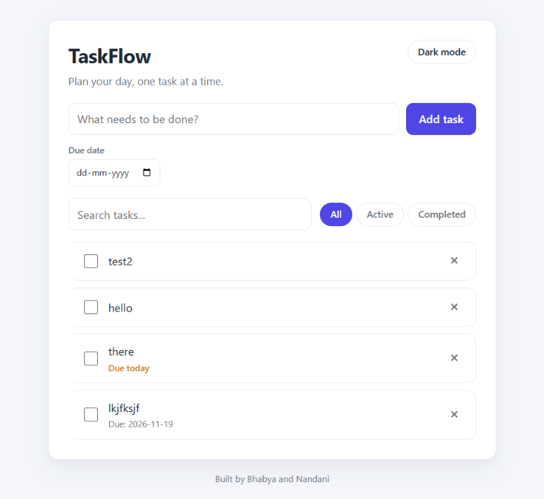
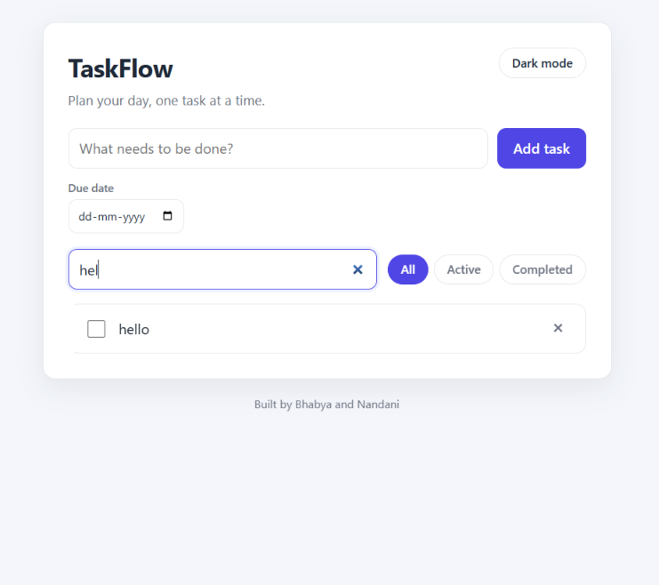
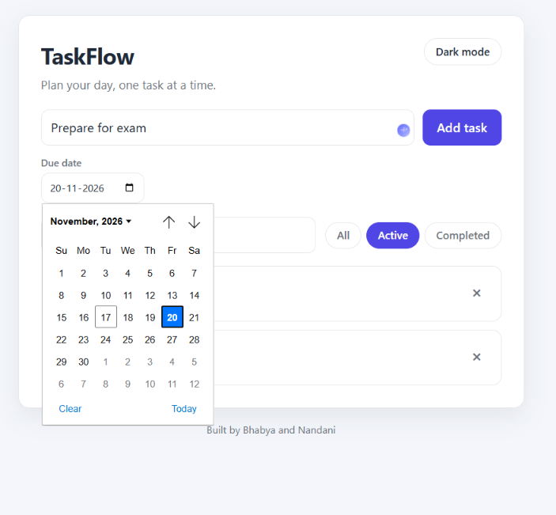
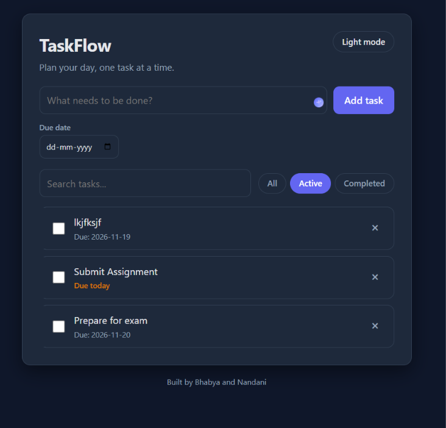
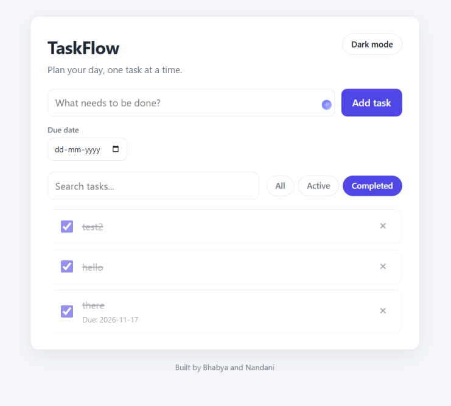

# To-Do List and Task Management System

A simple, colourful web app to create, organise and track daily tasks, built by two MCA students as a group project for **SEC101: Advanced Tools and Applications**. The project is also a hands-on demonstration of **Git, GitHub and Markdown**: branching, pull requests, code review and merge-conflict resolution.

> **Repository:** <https://github.com/BhabyaKumar/todo-project>

---

## Table of Contents

1. [Objectives](#objectives)
2. [Team Members and Contributions](#team-members-and-contributions)
3. [Features](#features)
4. [Technologies Used](#technologies-used)
5. [Project Structure](#project-structure)
6. [Installation and Execution](#installation-and-execution)
7. [Screenshots](#screenshots)
8. [Git Workflow Summary](#git-workflow-summary)
9. [Contributing](#contributing)

---

## Objectives

- Build a working **To-Do List and Task Management System** with at least five features.
- Practise **version control** with Git: commits, branches, merging and conflict resolution.
- Collaborate through **GitHub** using feature branches, pull requests and code reviews.
- Document the project properly using **Markdown**.

## Team Members and Contributions

| Member                | Roll No.   | GitHub                                                     | Main Contributions                                                                   |
| --------------------- | ---------- | ---------------------------------------------------------- | ------------------------------------------------------------------------------------ |
| Bhabya Kumar Lal      | 22         | [@BhabyaKumar](https://github.com/BhabyaKumar)             | Repository setup, core features (add, complete, delete), theme, due date, UI styling |
| [Nandini's full name] | [roll no.] | [@Nandini-Gupta3101](https://github.com/Nandini-Gupta3101) | Search, filter, colourful style update                                               |

Full details of branches, pull requests and reviews are in [CONTRIBUTING.md](CONTRIBUTING.md).

## Features

- [x] **Add** a new task
- [x] **Complete** a task (mark as done)
- [x] **Delete** a task
- [x] **Due date** for each task
- [x] **Search** tasks by text
- [x] **Filter** tasks by status
- [x] **Theme** switching (look and feel)
- [ ] [Local storage persistence, keep this line only if implemented]

## Technologies Used

| Area                      | Technology |
| ------------------------- | ---------- |
| Structure                 | HTML5      |
| Styling                   | CSS3       |
| Logic                     | JavaScript |
| Version control           | Git        |
| Hosting and collaboration | GitHub     |
| Documentation             | Markdown   |

## Project Structure

```text
todo-project/
├── css/
│   ├── dueDate.css     # Due date styles
│   ├── filter.css      # Filter feature styles
│   ├── search.css      # Search feature styles
│   ├── style.css       # Base styles
│   └── theme.css       # Theme styles
├── js/
│   ├── app.js          # App entry point
│   ├── dueDate.js      # Due date logic
│   ├── filter.js       # Filter logic
│   ├── search.js       # Search logic
│   ├── storage.js      # Data storage
│   ├── tasks.js        # Add, complete, delete tasks
│   └── theme.js        # Theme switching
├── .gitignore          # Files ignored by Git
├── CONTRIBUTING.md     # Contribution, branch, PR and review details
├── index.html          # Main page
└── README.md           # Project documentation
```

## Installation and Execution

**Requirements:** a modern web browser and [Git](https://git-scm.com/).

1. **Clone** the repository:

   ```bash
   git clone https://github.com/BhabyaKumar/todo-project.git
   cd todo-project
   ```

2. **Run** the app by opening `index.html` in your browser:

   ```bash
   # Windows
   start index.html

   # macOS
   open index.html
   ```

## Screenshots

### TaskFlow Dashboard

The main task list, including task creation, due dates and status filters.



### Search Tasks

Search for a task by its title.



### Due Dates and Active Tasks

Set a due date and view active tasks.



### Dark Mode

Switch the interface to the dark theme.



### Completed Tasks

View tasks that have been marked as completed.



## Git Workflow Summary

| Item             | Details                                                                                     |
| ---------------- | ------------------------------------------------------------------------------------------- |
| Default branch   | `main`                                                                                      |
| Feature branches | `feature-search`, `feature-dueDate`, `feature-drakKnight`, `feature-Colourfull`             |
| Pull requests    | #1 `feature-search`, #2 `feature-dueDate`, #3 `feature-drakKnight`, #4 `feature-Colourfull` |
| Merge conflict   | Resolved on PR #4. See [CONTRIBUTING.md](CONTRIBUTING.md)                                   |

View the history yourself:

```bash
git log --oneline --graph --all
```

## Contributing

Please read [CONTRIBUTING.md](CONTRIBUTING.md) for the branching strategy, pull request process and review rules.

---

_Made with care by two MCA students at the Department of Computer Science, University of Delhi._
